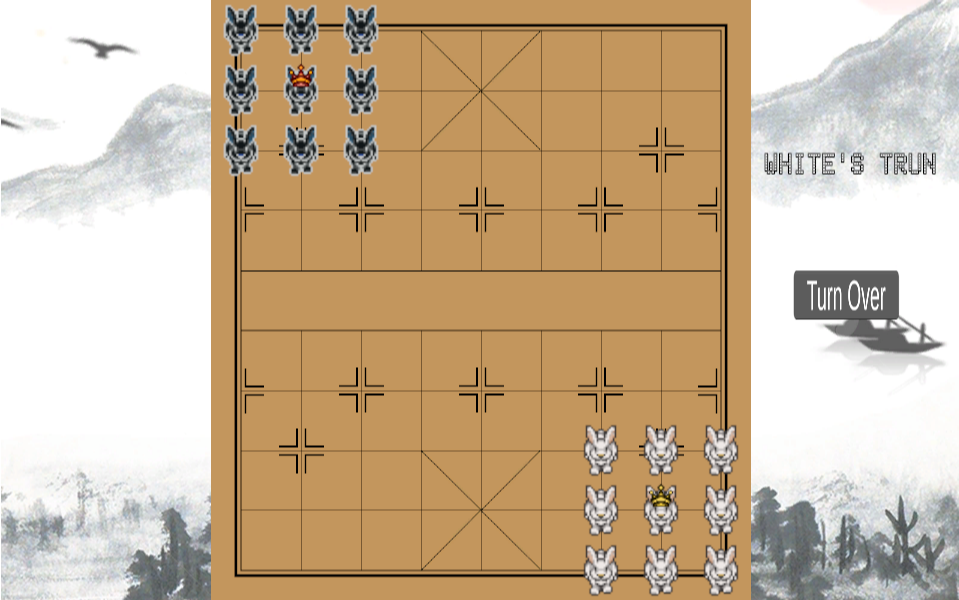
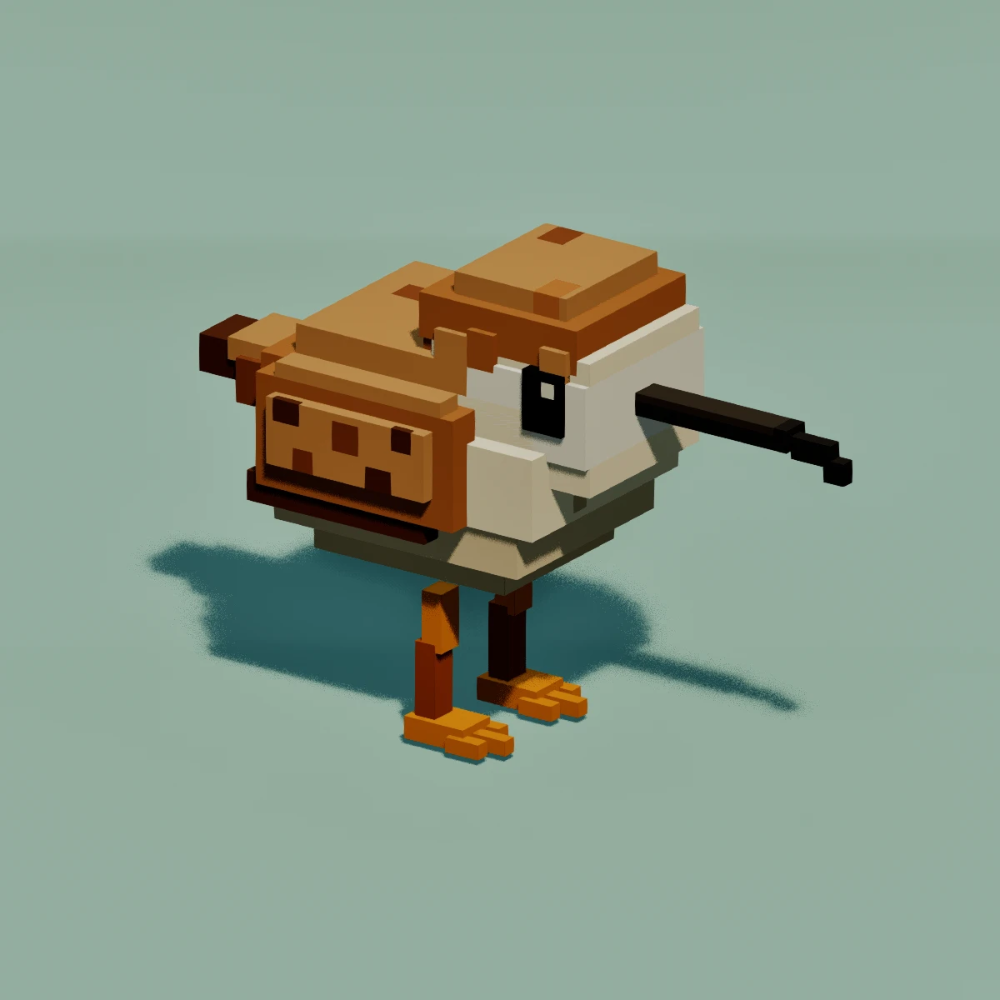
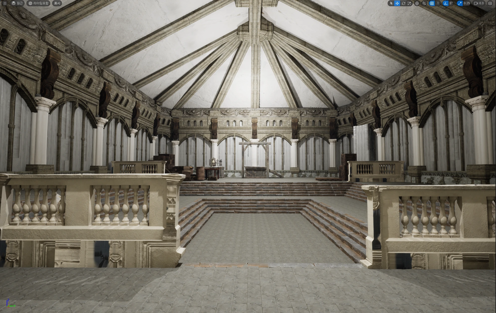

# 안녕하세요, 게임 클라이언트 프로그래머 지망생입니다 🎮

플레이어의 판단과 조작이 곧바로 결과로 이어지는 게임을 만들고 싶습니다.
기능을 하나씩 구현하고 검증한 뒤 다음 기능을 연결하는 방식으로 개발합니다.

**Unity · C# · Unreal Engine 5 · C++ · Blueprint · Git**

---

## 🐰 토끼장기 (Rabbit Janggi) — 완성

> Unity와 C#으로 만든 턴제 전략 보드게임

| | |
|---|---|
| ▶ 플레이 (브라우저) | [itch.io에서 바로 플레이](https://kissssshot.itch.io/rabbit-jangqqi) |
| 💻 소스 코드 | [GitHub 저장소](https://github.com/kissSsshot/Rabbit-Janggi) |
| 🛠 기술 | Unity, C#, WebGL |

**승리 조건:** 상대 토끼의 시작 지점에 3×3 진형을 이루고, 그 중앙에 왕이 위치하면 승리

**구현한 것**
- 흰 팀 / 검은 팀 턴 시스템과 턴 진행 UI
- 일반 이동과 상대 말을 뛰어넘는 연속 점프
- 3×3 진형 승리 판정과 승리·게임오버 화면
- WebGL 빌드 후 itch.io 배포

**해결한 문제**
- **연속 점프 중 좌표 불일치:** 월드 좌표와 Grid 좌표가 어긋나 다음 점프를 판정하지 못했습니다. 두 좌표를 구분해 갱신하고, 점프 상태와 현재 조작 중인 말을 별도로 관리해 해결했습니다.
- **한 팀에서만 동작하는 승리 판정:** 흰 팀은 승리 조건을 만족하면 게임이 끝났지만 검은 팀은 끝나지 않았습니다. 특정 왕 개체가 아닌 팀 단위로 승리 조건을 검사하도록 바꿔 두 팀에 같은 규칙이 적용되게 했습니다.
- **AI 활용 방식:** 생성형 AI가 일반적인 장기 규칙('왕을 잡으면 종료')을 전제로 답했을 때 실제 규칙을 다시 명세해 전달했습니다. AI 답변은 기존 클래스 구조와 충돌하는지 확인하고 Unity에서 실행해 검증한 것만 반영했습니다.

---

## 🐦 DOYO (가제 TIDELAND) — 개발 중

> 도요새가 갯벌에서 먹이를 찾는 탑뷰 캐주얼 포레이징 액션

| | |
|---|---|
| 🛠 기술 | Unreal Engine 5, C++, Blueprint |
| 🎯 MVP 성공 기준 | "10초 동안 움직이는 것만으로 재미있는가" |

- **구조 설계:** 게임 규칙은 C++, 연출은 Blueprint로 역할을 나눴습니다.
- **개발 순서를 먼저 확정:** 캐릭터 이동 → 탑다운 카메라 → 이동 연출(Bobbing) → 채집 → 에너지 → 밀물 시스템 순으로 구현합니다.
- **핵심 아이디어:** 도요새의 까딱거리는 움직임 자체를 재미로 삼고, 이동 속도 선택(탐색 vs 회피 vs 스태미나)을 전략으로 연결합니다. 밀물이 차오르며 긴장감을 만들고, 한 판은 3~5분입니다.
- **AI 활용:** 이미 만든 3D 모델 팩과 어울리는 콘셉트 이미지를 생성하며 비주얼 방향을 탐색하고 있습니다.

---

## 🏰 군타 (Gunta) — 미완

> Unreal Engine 5로 제작한 프로젝트 (중단)

---

## 📈 개발 과정

1. **첫 Unreal 소울라이크 프로젝트 (중단):** Blueprint로 이동과 탈부착식 무기까지 구현했지만, 개발 순서를 정하지 못해 중단했습니다.
2. **토끼장기 (완성):** 범위를 줄여 Unity와 C#으로 약 3개월간 개발하고, 처음으로 게임을 끝까지 완성했습니다.
3. **DOYO (진행 중):** 그 경험을 바탕으로 기획과 구현 구조를 먼저 설계한 뒤 다시 Unreal Engine으로 개발하고 있습니다.

---
